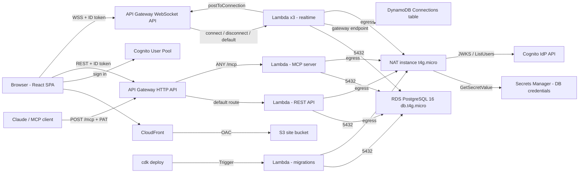

# Clara

[](https://github.com/Sharann-del/Clara/actions/workflows/ci.yml)
[](LICENSE)

System design documentation that stays in step with the system. Clara keeps markdown documents
and architecture diagrams in one place. You can write diagrams as code (Clara DSL or Mermaid),
drill down C4-style with no depth limit, step through named states to show how a system changes,
and edit together in real time. An MCP server lets AI assistants propose edits, and a person
reviews each one before it lands.

Clara runs entirely on AWS (CloudFront, API Gateway, Lambda, RDS PostgreSQL, Cognito, DynamoDB),
defined in one CDK stack. A native SwiftUI iOS app uses the same backend.

## Features

- **Documents and diagrams together.** Markdown documents with a rich-text mode. Diagrams embed
  inline and render live.
- **Diagrams as code.** Write the Clara DSL or paste Mermaid and get an auto-laid-out diagram (Dagre).
  Any diagram exports back to Mermaid.
- **A freeform canvas.** Shapes, connectors that follow their shapes, text and groups. Drag,
  resize, pan, zoom and multi-select, with an inspector for colours and links.
- **Unlimited C4 drill-down.** Any shape can open a child diagram, at any depth.
- **Named states and present mode.** Store per-element overrides (visibility, style, position) for
  states such as *current*, *interim* and *future*, then step through them or auto-play them full screen.
- **Real-time collaboration.** Presence, live cursors, live typing and live canvas edits over a
  WebSocket, with per-element last-write-wins conflict resolution.
- **AI edits with human review.** An MCP server (streamable HTTP) lets Claude and other MCP clients read
  everything you can read. Every write is staged as a pending change that a person accepts or
  rejects from a diff.
- **Sharing.** Workspace roles (viewer, editor, admin, owner), per-item grants and revocable public
  read-only links.
- **History and export.** Full version history with preview, diff and restore. Diagrams export to
  SVG, PNG, PDF and Mermaid; documents export to markdown.
- **A public playground.** `/editor` renders the DSL or Mermaid in the browser without an account.
  Its state lives in the URL, so a link is the share.

## Architecture



The same diagram is in [`docs/aws-architecture.mmd`](docs/aws-architecture.mmd), ready to import
into Clara itself. See [docs/architecture.md](docs/architecture.md) for how the pieces fit together
and [docs/aws-report.md](docs/aws-report.md) for the design trade-offs, security review, costs and
scaling limits.

## Quick start

You need Node.js 22, npm 10 and PostgreSQL 16. Sign-in uses a real Cognito user pool, so deploy the
stack once first ([self-hosting on AWS](docs/self-hosting-aws.md)) or point at an existing pool.

```bash
git clone https://github.com/Sharann-del/Clara.git
cd Clara
npm install

# Try the public site and playground. No backend is needed for /, /editor or /docs.
cp packages/frontend/.env.example packages/frontend/.env
npm run frontend:dev            # http://localhost:5173
```

To run the full app locally against your own user pool:

```bash
createdb clara
export DATABASE_URL=postgres://localhost/clara
npm run api:migrate

cp packages/api/.env.example packages/api/.env   # fill in USER_POOL_ID / USER_POOL_CLIENT_ID
set -a; . packages/api/.env; set +a
npm run api:dev                 # http://localhost:3001

# In packages/frontend/.env set VITE_API_URL=http://localhost:3001 plus the same pool IDs
npm run frontend:dev
```

[docs/getting-started.md](docs/getting-started.md) walks through this step by step, including
what does and doesn't work without the deployed WebSocket API.

## Tech stack

| Layer | Technology |
| --- | --- |
| Frontend | React 18, React Router 6, Vite 6, TypeScript, `amazon-cognito-identity-js`, `marked`, `turndown` |
| Diagram engine | `@clara/shared`: DSL and Mermaid parsers, Dagre layout, one SVG renderer for every view and export |
| API | Fastify 5 on AWS Lambda (`@fastify/aws-lambda`), `pg`, Zod, `aws-jwt-verify` |
| Realtime | API Gateway WebSocket API, three Lambdas, DynamoDB connections table |
| MCP | `@modelcontextprotocol/sdk`, stateless streamable HTTP on Lambda, personal access tokens |
| Data | Amazon RDS for PostgreSQL 16, SQL migrations applied by a CDK Trigger on every deploy |
| Auth | Amazon Cognito user pool (email and password) |
| Infrastructure | AWS CDK v2 (TypeScript), one stack: `ClaraStack` |
| iOS | SwiftUI (iOS 18+), JavaScriptCore running a bundle of `@clara/shared` |
| Tests | Node's test runner via `tsx`, Jest (CDK assertions), Playwright |

## Repository structure

```
.
├── docs/                      Project documentation (start at docs/getting-started.md)
├── ios/                       Native SwiftUI app (see ios/README.md)
├── packages/
│   ├── shared/                Framework-free diagram code shared by every package
│   ├── api/                   Fastify REST API, WebSocket Lambdas, SQL migrations
│   ├── mcp-server/            MCP server Lambda and its integration scripts
│   ├── frontend/              React SPA: public site, playground and the signed-in app
│   └── infra/                 AWS CDK stack
└── .github/                   CI, release workflow, issue and PR templates
```

| Package | What it is |
| --- | --- |
| [`packages/frontend`](packages/frontend) | The public site (landing page, playground, docs, pricing, legal) and the signed-in app |
| [`packages/api`](packages/api) | REST API (runs as a Lambda), WebSocket Lambdas, SQL migrations |
| [`packages/mcp-server`](packages/mcp-server) | MCP server on `/mcp`. Reads go through the API's services; writes become pending changes |
| [`packages/shared`](packages/shared) | DSL/Mermaid parsing and layout, the SVG renderer, diagram diffing, embed parsing, onboarding content |
| [`packages/infra`](packages/infra) | The CDK stack (see its [README](packages/infra/README.md)) |

## Documentation

| Guide | |
| --- | --- |
| [Getting started](docs/getting-started.md) | Run Clara locally |
| [Self-hosting on AWS](docs/self-hosting-aws.md) | Deploy to a fresh account, upload the frontend, keep the bill down |
| [Configuration](docs/configuration.md) | Every environment variable and CDK context flag |
| [Architecture](docs/architecture.md) | Packages, request flows and data model |
| [API](docs/api.md) and [routes](docs/routes.md) | REST, WebSocket and public endpoints |
| [MCP setup](docs/mcp-setup.md) | Connect Claude Code or another MCP client |
| [Realtime](docs/realtime.md) | The WebSocket protocol and conflict resolution |
| [Sharing and permissions](docs/sharing-and-permissions.md) | Roles, grants and public links |
| [Testing](docs/testing.md) | Unit, infrastructure, integration and end-to-end tests |
| [Troubleshooting](docs/troubleshooting.md) | Common problems and fixes |
| [Roadmap](docs/roadmap.md) | What's planned next |

## Contributing

Contributions are welcome. Read [CONTRIBUTING.md](CONTRIBUTING.md) to get set up and
[CODE_OF_CONDUCT.md](CODE_OF_CONDUCT.md) before taking part. To report a vulnerability, follow
[SECURITY.md](SECURITY.md) and don't open a public issue.

## License

[MIT](LICENSE) © 2026 Sharann M and Dhriti
