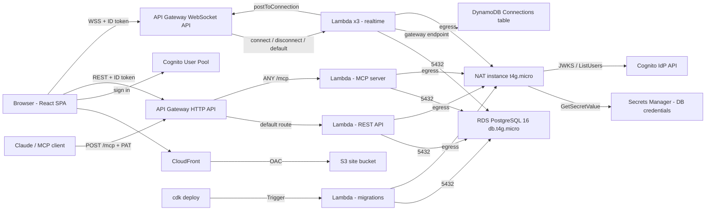

# Architecture

This page explains how Clara is put together: the packages, what runs where, how a request moves
through the system and how the data is stored. For the trade-offs behind each choice, the security
review and scaling limits, read the [AWS architecture report](aws-report.md).

## The packages

```
packages/shared  ──►  packages/api  ──►  packages/mcp-server
       │                    │
       ├──────────►  packages/frontend
       └──────────►  ios/ (bundled into JavaScriptCore)
packages/infra   deploys api, mcp-server and the frontend's hosting
```

| Package | Role |
| --- | --- |
| `@clara/shared` | Framework-free TypeScript used everywhere. `dsl` (Clara DSL and Mermaid parsers, Dagre layout, Mermaid export), `render` (the one SVG renderer behind every view and export), `diff` (diagram diffing for review), `elements` (element normalization), `embeds` (the markdown embed parser that also scopes public links), `text` (label wrapping) and `onboarding` (first-run sample content). |
| `@clara/api` | Fastify REST API. Runs locally with `tsx` and on Lambda through `@fastify/aws-lambda`. Also holds the three WebSocket Lambdas (`src/ws`), the SQL migrations, the migration Lambda and the Cognito pre-sign-up trigger. All domain logic lives in `src/lib` as plain functions that REST, WebSocket and MCP share. |
| `@clara/mcp-server` | The MCP server. Imports `@clara/api`'s service layer directly, so AI reads use the same permission checks as people, and writes go through `lib/pending.ts`, which only stages proposals. |
| `@clara/frontend` | React 18 single-page app built with Vite. It holds the public site (landing, playground, docs, pricing, legal, share links) and the signed-in app. |
| `@clara/infra` | The CDK app that defines the whole AWS stack. |
| `ios/` | A native SwiftUI client for the same backend. It runs a bundle of `@clara/shared` in JavaScriptCore and ports the geometry and palette for native drawing. |

## What runs where



| Component | AWS resource | Notes |
| --- | --- | --- |
| Static site | Private S3 bucket behind CloudFront (Origin Access Control) | Unknown paths return `index.html` so client-side routes survive a refresh |
| Sign-in | Cognito user pool and a public web client | Email and password; ID tokens last 1 hour, refresh tokens 30 days. An optional pre-sign-up trigger enforces an allowlist or invite codes |
| REST API | HTTP API (`$default` stage, throttled) → `ApiFn` (512 MB, 20 s) | Authenticates every request with `aws-jwt-verify`; there's no gateway authorizer |
| MCP | Same HTTP API, `ANY /mcp` → `McpFn` (512 MB, 25 s) | Stateless streamable HTTP; authenticates personal access tokens |
| Realtime | WebSocket API (`prod` stage, throttled) → connect, disconnect and default Lambdas | Connections live in DynamoDB with `RoomIndex` and `UserIndex` GSIs |
| Database | RDS PostgreSQL 16, `db.t4g.micro`, private subnets, encrypted | Credentials generated into Secrets Manager |
| Migrations | `MigrateFn`, run by a CDK Trigger on every deploy | The API Lambdas depend on it, so new code never meets an old schema |
| Egress | One `t4g.micro` NAT instance (or a NAT gateway with `natMode=gateway`) | For Secrets Manager, Cognito and the WebSocket management API. DynamoDB traffic uses a free gateway endpoint |

Every application Lambda runs Node.js 22 in the private subnets on one shared security group. RDS
accepts connections on 5432 from that security group only.

## Request flows

**Loading the site.** CloudFront serves the bundle from S3. The landing page, playground and docs
work without an account. The playground renders entirely in the browser with `@clara/shared`.

**Signing in.** The SPA talks to Cognito directly with `amazon-cognito-identity-js` and keeps the
session in local storage. The iOS app calls Cognito's `InitiateAuth` with `USER_PASSWORD_AUTH` and
keeps tokens in the Keychain.

**A REST call.** The browser sends its Cognito ID token in an `Authorization: Bearer` header. The Lambda verifies the
token's signature, issuer, expiry, `token_use` and audience, then the route calls a service in
`src/lib`. The service resolves the caller's effective role (`lib/authz.ts`) before touching data,
and updates snapshot the previous state into `versions` in the same transaction.

**Live editing.** Each open document or diagram opens one WebSocket. `$connect` verifies the token
from the query string, checks access and connection limits, and records the connection in DynamoDB.
Canvas edits are single-row SQL writes followed by a broadcast to the room. See
[realtime.md](realtime.md).

**An AI edit.** An MCP client calls `POST /mcp` with a personal access token. Reads return data the
token's owner can see. Writes insert a row in `pending_mcp_changes` and change nothing else. A
person reviews the diff in the web app; accepting replays the change through the normal services
**as the reviewer**, with a version snapshot. See [mcp-setup.md](mcp-setup.md).

**A public link.** `/s/:token` calls the unauthenticated `GET /public/:token` routes. A document link
exposes only the diagrams that document embeds. See [sharing-and-permissions.md](sharing-and-permissions.md).

## Data model

PostgreSQL holds everything durable. User IDs are Cognito `sub` values; Clara keeps no users table
and looks emails up in Cognito when it needs them.

| Table | Key columns | Notes |
| --- | --- | --- |
| `workspaces` | `id`, `name` | |
| `workspace_members` | `workspace_id`, `user_id`, `role` | `owner`, `admin`, `editor` or `viewer` |
| `folders` | `id`, `workspace_id`, `parent_folder_id`, `name` | Nested to any depth |
| `documents` | `id`, `workspace_id`, `folder_id`, `title`, `content_md`, `tags[]` | `workspace_id` is stored directly so root-level items resolve in one join |
| `diagrams` | `id`, `workspace_id`, `folder_id`, `parent_diagram_id`, `name`, `tags[]` | |
| `diagram_elements` | `id`, `diagram_id`, `type`, `geometry`, `style`, `z_index`, `linked_diagram_id`, `parent_group_id` | One row per shape, so concurrent edits to different shapes never conflict. `linked_diagram_id` is the C4 drill-down link |
| `diagram_source` | `diagram_id`, `dsl_text`, `format` | The Code tab source, `clara` or `mermaid` |
| `diagram_states` | `id`, `diagram_id`, `name`, `order_index`, `element_overrides` | Named states with per-element visibility, style and position overrides |
| `permissions` | `resource_type`, `resource_id`, `user_id`, `role` | Direct per-item grants |
| `versions` | `resource_type`, `resource_id`, `snapshot`, `created_by` | Full snapshot per save |
| `personal_access_tokens` | `user_id`, `name`, `token_prefix`, `token_hash`, `expires_at`, `revoked_at` | SHA-256 hash only; the plaintext is shown once |
| `pending_mcp_changes` | `workspace_id`, `resource_type`, `resource_id`, `operation`, `diff_payload`, `status`, `proposed_by`, `token_id` | `diff_payload` holds the proposal and the base it was made against, for stale detection |
| `favorites` | `user_id`, `resource_type`, `resource_id` | |
| `share_links` | `token`, `resource_type`, `resource_id`, `revoked_at` | 192-bit random token |
| `onboarded_users` | `user_id` | First-run setup happens once per account |
| `schema_migrations` | `name` | Applied migrations |

Triggers keep `updated_at` current and clean up permissions, favorites and share links when a
document or diagram is deleted. The DynamoDB `Connections` table holds only live WebSocket
connections, each with a TTL.

## Design rules worth knowing

- **One renderer.** `renderDiagramSvg` in `@clara/shared/render` draws the canvas preview,
  playground, embeds, share links, and the server and client exports. The canvas uses a dark
  palette; exports default to the light one.
- **One permission check.** `assertResourceRole` computes the effective role (the higher of the
  workspace role and any direct grant) for REST, WebSocket and MCP alike.
- **AI never writes directly.** The guarantee is enforced in code: the MCP tools can only call
  `propose*` functions. [aws-report.md §3.4](aws-report.md#34-secrets-and-the-things-i-would-fix)
  explains how a least-privilege database role would make it a database guarantee too.
- **Markdown is untrusted.** Raw HTML is escaped and link and image URLs are filtered, because
  documents can be public.
