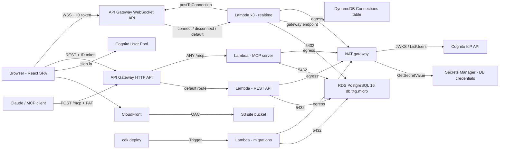

# Clara — AWS Cloud Architecture Report

**Course project write-up · Stack `ClaraStack` · region `eu-north-1` (Stockholm) · account verified via `aws sts` / CloudFormation, 2026-10-02**

This report describes what is actually deployed, derived from the CDK code in `packages/infra`, the application code in `packages/api` and `packages/mcp-server`, and read-only AWS calls against the live stack (`cloudformation list-stack-resources`, `lambda list-functions`, `rds describe-db-instances`, `ec2 describe-nat-gateways`, `lambda get-account-settings`, and the AWS Pricing API). Where a number or claim comes from general AWS knowledge instead of the code or a live query, it is marked **(unverified)**.

---

## 1. Architecture overview

Clara is a system-design documentation tool: markdown documents, a freeform diagram canvas, real-time collaboration, and an MCP server that lets an AI assistant propose edits that a human reviews. It is a single CloudFormation stack made of eight CDK constructs (`Network`, `Frontend`, `Compute`, `Database`, `Auth`, `Api`, `Realtime`, `McpServer`).

### 1.1 Services in use

| Service | Resources (live) | What it does in Clara |
|---|---|---|
| **VPC** | `10.0.0.0/16`, 2 AZs, 2 public + 2 private `/24` subnets, internet gateway, 2 security groups | Network boundary. Lambdas and RDS live in the private subnets. |
| **NAT gateway** | 1 NAT + 1 Elastic IP (single AZ) | Outbound-only internet for the private Lambdas: Secrets Manager, Cognito (JWKS download, `ListUsers`), and the API Gateway WebSocket management API. |
| **VPC gateway endpoint** | 1 (DynamoDB) | Keeps DynamoDB traffic off the NAT. Free. |
| **S3** | 1 private bucket (SSE-S3, block-public-access, TLS-only) | Holds the built React bundle. Not reachable except through CloudFront (Origin Access Control). |
| **CloudFront** | 1 distribution, `PriceClass_100`, HTTPS redirect, 403/404 → `/index.html` | Serves the SPA. The error rewrite makes client-side routes work on refresh. |
| **API Gateway HTTP API** | 1 API, default route → REST Lambda, `ANY /mcp` → MCP Lambda | Public entry point for REST and MCP. CORS limited to the CloudFront origin and `localhost:5173`. |
| **API Gateway WebSocket API** | 1 API, stage `prod`, routes `$connect`, `$disconnect`, `$default` | Real-time channel for live cursors, element edits and presence. |
| **Lambda** | 6 application functions + 3 CDK helper functions (see 1.2) | All compute. Node.js 22, bundled with esbuild, no containers. |
| **RDS for PostgreSQL** | `db.t4g.micro`, Postgres 16.13, single-AZ, 20 GB gp3, encrypted, not public, 1-day backups | System of record: workspaces, members, folders, documents, diagrams, elements, states, versions, personal access tokens, pending MCP changes. |
| **Cognito** | 1 user pool, 1 public web client (no secret) | Sign-up/sign-in, password policy, ID tokens (JWTs) the API and WebSocket verify. |
| **DynamoDB** | 1 on-demand table `Connections` + GSI `RoomIndex`, TTL on `expiresAt` | Active WebSocket connections, so any Lambda can find everyone viewing the same document or diagram. |
| **Secrets Manager** | 1 secret `clara/rds/admin` | Generated DB master credentials, read by Lambdas at cold start. |
| **IAM** | 9 roles (one per Lambda) + policies | Per-function least-privilege grants (see §3). |
| **CloudWatch Logs** | 1 log group per Lambda, **no retention set** | Function logs. |
| **ECS** | 1 empty cluster (`Compute` construct) | Leftover from the original Fargate plan. No services, no tasks, no cost. Safe to delete. |

### 1.2 Lambda functions

| Function | Entry | Memory / timeout | Trigger |
|---|---|---|---|
| REST API (`ApiFn`) | `api/src/lambda.ts` (Fastify via `@fastify/aws-lambda`) | 512 MB / 20 s | HTTP API default route |
| MCP server (`McpFn`) | `mcp-server/src/lambda.ts` | 512 MB / 25 s | HTTP API `ANY /mcp` |
| Realtime connect / disconnect / default | `api/src/ws/*-lambda.ts` | 256 MB / 15 s, 15 s, 20 s | WebSocket routes |
| Migrations (`MigrateFn`) | `api/src/migrate-lambda.ts` | 256 MB / 90 s | CDK `Trigger` on every deploy |
| 3 CDK helpers | (auto-generated) | 128 MB / 900 s | Custom resources (auto-delete bucket, restrict default SG, trigger provider) |

All application Lambdas run in the private subnets on one shared security group (`AppSecurityGroup`).

### 1.3 Diagram

The diagram below is in the Mermaid subset that Clara's own importer supports (`A[Label] --> B[Label]`, `A -->|text| B`; one edge per statement). I verified it through `parseMermaid` and the layout engine: 17 nodes, 22 edges, all parsed. The same text is in [`docs/aws-architecture.mmd`](aws-architecture.mmd) for direct import (diagram → Import Mermaid).



### 1.4 How a request flows from browser to database

**A. Loading the app.** The browser requests the CloudFront URL. CloudFront serves the bundle from the private S3 bucket through its Origin Access Control. Unknown paths return `index.html` so React Router can handle them.

**B. Signing in.** The SPA uses `amazon-cognito-identity-js` against Cognito directly (the client allows SRP and plain-password flows; no secret, so it is a public client). Cognito returns an ID token (1 h), an access token (1 h) and a refresh token (30 days).

**C. A REST call** (e.g. `PATCH /documents/:id`):
1. Browser → `https://<api-id>.execute-api.eu-north-1.amazonaws.com/…` with `Authorization: Bearer <ID token>`.
2. HTTP API invokes the REST Lambda. **There is no API Gateway authorizer**; authentication is a Fastify `preHandler` (`api/src/auth.ts`).
3. `aws-jwt-verify` checks the token's signature (keys fetched once from Cognito's JWKS and cached per container), issuer, expiry, `token_use = id` and `aud` = the app client.
4. The service layer (`lib/documents.ts`) looks up the caller's role in `workspace_members` and enforces viewer / editor / admin / owner.
5. The query runs on a `pg` pool against RDS (security group allows 5432 only from the app security group). Updates snapshot the previous state into `versions` in the same transaction.
6. JSON returns the same way.

On a **cold start** the Lambda first calls Secrets Manager (via the NAT) for DB credentials, then opens its pool. The pool is process-wide, so warm invocations skip this.

**D. Real-time editing.** The page opens one WebSocket per open document/diagram: `wss://…/prod?token=<ID token>&resourceType=…&resourceId=…` (browsers cannot set headers on a WebSocket handshake, hence the query string).
- `$connect` verifies the JWT, checks the user's role on that resource, writes a row to DynamoDB (`room = "<type>#<id>"`, TTL 4 h) and broadcasts presence.
- `$default` handles `cursor`, `element.create/update/delete`, `state.override`, `presence.sync`. Element mutations are single-row SQL statements on RDS, then `broadcastToRoom` queries the `RoomIndex` GSI and calls `postToConnection` for every other connection (through the NAT to the management API).
- `$disconnect` deletes the row and announces `presence.left`.

**E. An AI assistant (MCP).** Claude → `POST /mcp` with `Authorization: Bearer clara_pat_…` → HTTP API → MCP Lambda → token hash lookup in `personal_access_tokens` → a per-request MCP server bound to that user. **Reads** go through the same services as REST (so the same roles apply). **Writes are never applied**; they insert a row in `pending_mcp_changes`. A human opens "Pending changes" in the web app, reviews the diff and Accepts (the change replays through the same services as that reviewer, with a version snapshot) or Rejects.

---

## 2. Design decisions and tradeoffs

### 2.1 Lambda vs Fargate (and why Fargate was dropped)

The PRD named ECS Fargate behind an ALB for both the API and the MCP server, and listed it as an open question (§8). What actually happened:

- **API → Lambda.** The recorded reason (`infra/README.md`, `lib/api.ts`) is practical: building and pushing a Fargate image needs Docker, which was not available in the development environment, whereas `NodejsFunction` bundles with esbuild and needs no container runtime. Cost was the other benefit.
- **MCP server → Lambda, decided explicitly.** I asked before assuming anything that affected cost, and the choice was Lambda on the existing HTTP API (`ANY /mcp`) rather than a second Fargate service. A Fargate service would add an always-on task plus an ALB (my rough figures at the time were about $9+/mo and $16+/mo; **unverified**, not priced for Stockholm). The Lambda route adds no fixed cost.
- **Empty ECS cluster.** The `Compute` construct still creates an ECS cluster. It has no services and no cost, but it is dead weight and the comments on it are stale. It should be removed, or kept only if a Fargate service is planned.

**What Lambda costs us:**
- No long-lived connections, so WebSockets need API Gateway's WebSocket API plus a DynamoDB connection table instead of in-process state. This is real extra architecture (and arguably a better course demo of managed services).
- The MCP transport must be stateless: every `POST` builds a fresh server and returns one JSON response (`enableJsonResponse`); `GET` and `DELETE` return 405. API Gateway's ~30 s integration limit is why the MCP Lambda's timeout is 25 s.
- VPC cold starts, plus a Secrets Manager call on each cold start.
- **A concurrency ceiling (see §5):** this account's Lambda concurrency limit is **10**.
- Many short-lived containers each holding a DB pool (see §5).

**What Fargate would give:** a single warm process with a persistent pool, in-process WebSocket fan-out, no per-account concurrency limit, easier live debugging for a demo. The price is the fixed monthly cost and operating a container pipeline.

### 2.2 Single NAT gateway vs VPC endpoints

The private Lambdas need outbound access to three AWS services that are not on a free gateway endpoint: **Secrets Manager** (DB credentials), **Cognito** (JWKS download for JWT verification; `ListUsers` for member invites) and the **API Gateway management API** (`postToConnection`). Only DynamoDB has a (free) gateway endpoint in the stack.

| Option | Fixed monthly cost | Notes |
|---|---|---|
| **1 NAT gateway (current)** | $33.58 + $3.65 public IPv4 ≈ **$37.2** | Simple. One AZ: if that AZ fails, private egress fails everywhere. |
| 2 NAT gateways (one per AZ) | ≈ $74 | Removes the egress SPOF. Not worth it for a course project. |
| Interface endpoints for the 3 services | ≈ 3 × $0.01/h × 730 h ≈ $22 per AZ, ≈ $44 for 2 AZs **(unverified; endpoint price not retrieved, availability of a Cognito IdP endpoint in this region not checked)** | Cheaper only at 1 AZ, and it removes the internet path entirely, a security plus. |
| NAT instance (`t4g.nano`) | ≈ $3–5 **(unverified)** | Cheapest, but self-managed and a single point of failure. |

At current scale one managed NAT is the simplest option and the endpoints are not clearly cheaper; the NAT is nevertheless the single largest line item (§4). The DynamoDB gateway endpoint is the one place an endpoint is a pure win (free, and it keeps the busiest realtime path off the NAT).

### 2.3 RDS `db.t4g.micro` vs Aurora Serverless v2

Chosen: plain RDS PostgreSQL 16, single-AZ `db.t4g.micro`, 20 GB gp3. `lib/config.ts` gives the reasons: it is the cheapest managed Postgres (free-tier eligible if the account qualifies) and PRD §8 flagged Aurora Serverless v2's cold-start/scale latency as a live-demo risk. No benchmark was run; this is a judgement call.

- **For RDS:** lowest fixed cost (~$14/mo), predictable latency, ordinary Postgres.
- **Against:** burstable CPU/RAM (2 vCPU, 1 GiB) shared by everything; single-AZ; fixed storage (autoscaling is effectively disabled, since `maxAllocatedStorage` equals `allocatedStorage`).
- **Aurora Serverless v2** shows autoscaling in the architecture story, but costs more at idle (it needs a minimum capacity, or resume time if it pauses), also needs the same VPC/NAT plumbing, and does not fix the connection-count problem by itself.

### 2.4 Last-write-wins for realtime

Documented in `api/src/ws/message-lambda.ts`. Each element mutation is a single-row SQL statement, so two people editing **different** shapes never conflict. Two people editing the **same** shape in the same instant are decided by whichever `UPDATE` commits last, and the loser's change is lost (not merged).

- **Why not a CRDT (e.g. Yjs):** it needs a shared CRDT document, an awareness protocol and a persistence format other than "one Postgres row per element", a lot of surface for 2–3 simultaneous editors.
- **Deliberate exceptions:** whole-diagram replacements (DSL apply, Mermaid import, version restore, accepted MCP changes) are last-writer-replaces-everything by design. Document text is whole-field last-write-wins via a debounced (600 ms) `PATCH`; the WebSocket only broadcasts live typing.
- **Known gaps:** a REST save (e.g. an accepted MCP change) is not pushed to tabs that already have the diagram open until they reload. The MCP review flow compensates for this specific hazard with a staleness check (below).

### 2.5 Personal access tokens for MCP

Chosen: `clara_pat_<256 random bits>` tokens, created in the web app, stored only as a SHA-256 hash, 90-day default expiry (1–365 days, or never), max 20 active per user, revocable, `last_used_at` updated at most once a minute.

- **Why not Cognito/OAuth for MCP:** no Cognito domain is provisioned (there is no `UserPoolDomain` in `auth.ts` or the live resource list), so the OAuth/hosted-UI endpoints do not exist; the `oAuth` block on the app client is effectively unused. Claude Code and Claude Desktop can send a static `Authorization` header, so a bearer token is the smallest workable thing.
- **A token carries no permissions of its own.** Every request resolves the owner's *current* workspace roles, so demoting a user immediately limits their tokens too.
- **Limitation:** claude.ai's custom-connector flow expects OAuth, which this does not implement.
- **Separation:** a PAT is rejected by the REST API and a Cognito ID token is rejected by `/mcp` (both are checked in the e2e test).

### 2.6 Diff-based review for AI writes

Every MCP create/update lands in `pending_mcp_changes` (`resource`, `diff_payload = {proposed, base}`, `status`, `proposed_by`, `token_id`, `summary`). Nothing touches `documents` or `diagrams` until a human accepts.

- **Accept** replays the change through the same service functions the REST routes use, **as the reviewer**, in one transaction with marking it accepted. Updates snapshot the prior state into `versions`, so every accepted AI edit is restorable. (Creates do not snapshot: there is no prior state.)
- **Stale detection:** if the target changed after the proposal (content comparison against `base`), accept returns 409 unless the reviewer forces it after seeing the diff against the live state.
- **Review UI:** line diff for documents; added / changed / removed elements with per-key before→after for diagrams.
- **Cost:** reviewer friction, and an AI that cannot see its change land until a human acts (`list_my_proposals` reports status).
- **Guardrails:** viewers cannot even propose; proposals are capped at 50 per user per workspace; document bodies at 500k characters; diagrams at 1000 elements.

> **Important caveat.** The "AI cannot write directly" guarantee is enforced **in code**, not by the database. The MCP Lambda connects with the same master credentials (`clara_admin`) as every other function, so a bug in the MCP code could write any table. See §3.4 for the recommended fix (a separate least-privilege DB role).

---

## 3. Security

### 3.1 Network
- RDS is `publiclyAccessible: false`, in private subnets, with its own security group. **Ingress: TCP 5432 from the app security group only; no outbound rules** (`allowAllOutbound: false`).
- All Lambdas are in private subnets. Nothing in the stack accepts inbound traffic from the internet except CloudFront, the two API Gateway APIs, and (indirectly) Lambda via API Gateway.
- `AppSecurityGroup` allows all outbound and has no inbound rules; every function shares it, so there is no per-function network segmentation.
- S3 is private (block-public-access, TLS-only bucket policy, SSE-S3) and reachable only through CloudFront's OAC. CloudFront redirects HTTP to HTTPS and uses the default `*.cloudfront.net` certificate (no custom domain, no WAF).

### 3.2 IAM (per-function, CDK-generated)
Each Lambda has its own execution role (9 roles in the live stack). Grants are made through CDK helpers, not wildcards:
- All app functions: `secretsmanager:GetSecretValue`/`DescribeSecret` on **the one DB secret**; VPC access and basic logging managed policies.
- REST Lambda: additionally `cognito-idp:ListUsers` scoped to this user pool's ARN (invite-by-email).
- Realtime functions: read/write on the `Connections` table (and its index) and `execute-api:ManageConnections` on this WebSocket API.
- **MCP Lambda: DB secret + VPC/logging only.** No Cognito, no DynamoDB, no S3.
- Role-per-function is good; the weak spot is that all of them read the *master* secret (see 3.4).

### 3.3 Authentication and authorization
- **JWT verification:** `aws-jwt-verify` against this user pool and client; `token_use = id`. Verified in the Lambda on every REST request and on WebSocket `$connect`. (There is no gateway-level authorizer, so unauthenticated requests still invoke a Lambda and are rejected inside it; `/health` is intentionally open.)
- **Cognito settings:** self sign-up, email auto-verify, password minimum 10 characters with lower/upper/digit (symbols not required), email-only recovery, ID/access tokens 1 h, refresh 30 days, `USER_PASSWORD_AUTH` and SRP both enabled.
- **Workspace roles:** `viewer < editor < admin < owner`, looked up in `workspace_members` **on every request** by the shared service layer, so REST, WebSocket and MCP use one rule set. Writes need editor or higher; member management needs admin; workspace deletion needs owner.
- **Per-resource permissions:** the `permissions` table holds direct per-item grants. *Update 2026-10-24 (in code, pending deploy):* every document/diagram load now goes through `assertResourceRole` (effective role = higher of workspace role and direct grant), so sharing is enforced in REST, MCP and the WebSocket alike, covered by `mcp-server/scripts/sharing-e2e.ts`. Deleting an item or moving it between folders still needs a workspace role. Public read-only links (`share_links`, 192-bit tokens, revocable) are served by unauthenticated `GET /public/:token` routes; a document link exposes only the diagrams that document embeds.
- **Token hashing:** PATs are 256-bit random values, stored as a SHA-256 hash with a short display prefix; lookup is by hash; the plaintext is returned once at creation. Hashing without a salt or work factor is appropriate here because the secret is high-entropy, not a human password.
- **Reviewer, not proposer, is the actor** on accept, so an AI cannot grant itself more than the human reviewing it has.

### 3.4 Secrets, and the things I would fix
- **Secrets Manager** generates and stores the RDS master credentials (`clara/rds/admin`); nothing is hard-coded in source or Lambda environment variables (only the secret's ARN). **No rotation is configured.**
- **DB TLS is not verified.** `db.ts` connects with `ssl: { rejectUnauthorized: false }`: encrypted in transit, but the server certificate is not validated. Fix: bundle the RDS CA and set `rejectUnauthorized: true`.
- **Shared master DB user.** Recommended: create separate Postgres roles. For the MCP Lambda, `SELECT` on content tables plus `INSERT`/`SELECT` on `pending_mcp_changes` and `personal_access_tokens` lookups only. That would turn the "AI cannot write directly" rule from a code convention into a database guarantee.
- **WebSocket token in the URL.** It is necessary because of the browser handshake limitation. API Gateway access logging is not enabled, so tokens are not logged today; enabling it would log them.
- **`retainData: false`.** RDS has `deletionProtection: false`, a `DESTROY` removal policy and 1-day backups. That is right for iterating, wrong for real data; flip it before storing anything you care about.
- **No WAF, no throttling configuration beyond API Gateway defaults.** A leaked PAT or ID token could drive load; this is bounded mainly by the Lambda concurrency limit (§5).
- **CloudWatch log groups never expire.**

---

## 4. Cost breakdown

**Prices:** `eu-north-1` on-demand list prices retrieved from the AWS Pricing API on 2026-10-02 unless marked **(unverified)**. 730 hours/month. Excludes tax and any free-tier or credits.

### 4.1 Fixed costs (incurred even when nobody uses the app)

| Service | Basis | $/month |
|---|---|---|
| NAT gateway | $0.046/h | **33.58** |
| Public IPv4 for the NAT Elastic IP | $0.005/h **(unverified)** | 3.65 |
| RDS `db.t4g.micro` Single-AZ PostgreSQL | $0.016/h | **11.68** |
| RDS storage, 20 GB gp3 | $0.12/GB-month | 2.40 |
| Secrets Manager, 1 secret | $0.40/secret | 0.40 |
| Everything else (ECS cluster, VPC, subnets, IGW, gateway endpoint, IAM, security groups) | no charge | 0.00 |
| **Fixed total** | | **≈ 51.7** |

If the AWS account is eligible for RDS free tier, the two RDS lines go to ~$0 for the free period (**unverified**; eligibility depends on account age and plan). RDS burstable instances also default to "unlimited" credits (**unverified**), which can add a small per-vCPU-hour surcharge under sustained load.

> This is higher than the figure in `packages/infra/README.md` ("~$15–47"). That table assumed `us-east-1` and a free-tier RDS; the stack is in Stockholm and the NAT price is $0.046/h there.

### 4.2 Usage-based costs

| Service | Unit price | Notes |
|---|---|---|
| NAT data processing | $0.046 per GB | Secrets, JWKS, `postToConnection` calls. Small. |
| HTTP API Gateway | $1.06 per million requests | REST + MCP. |
| Lambda requests | $0.20 per million | Free tier 1M requests/month **(unverified)**. |
| Lambda compute | $0.0000166667 per GB-second (x86) | Free tier 400k GB-s/month **(unverified)**. |
| WebSocket API | ≈ $1 per million messages + ≈ $0.25 per million connection-minutes **(unverified; list price from memory, not Stockholm)** | Cursor traffic dominates message count. |
| DynamoDB on-demand | $0.1345 per M reads, $0.67 per M writes | Writes only at connect/disconnect; reads on each broadcast. |
| CloudFront + S3 | free tier ≈ 1 TB / 10M requests **(unverified)** | Effectively $0 here; `PriceClass_100`. |
| Cognito | free for the first tens of thousands of monthly active users **(unverified; tier terms changed recently, check current terms)** | $0 at this scale. |
| CloudWatch Logs | ≈ $0.5/GB ingested, storage forever **(unverified)** | Pennies. |

### 4.3 Three scenarios (illustrative; my assumptions, not measurements)

| Scenario | Assumptions | Variable $ | **Total $/month** |
|---|---|---|---|
| **Idle / demo** | a few requests a day | ≈ 0–1 | **≈ 52** |
| **Small team** | ~3M REST+MCP requests, ~2M WebSocket messages, 20 GB NAT data | ≈ 8 (API GW 3.2, WebSocket ≈ 2, Lambda ≈ 0.5, NAT data 0.9, misc) | **≈ 60** |
| **Busy collaboration** | heavy live-cursor use (see §5, concurrency becomes the issue before cost does) | tens of dollars | the cap is concurrency, not the bill |

### 4.4 How to reduce it

| Change | Saves (≈) | Trade-off |
|---|---|---|
| **`cdk destroy` between demos** (`retainData: false` makes this clean) | ~$52/mo while off | Data is lost. Take a snapshot first, or set `retainData: true` and accept the RDS cost. |
| Replace the NAT gateway with a `t4g.nano` NAT instance | ≈ $30–33 **(unverified)** | Self-managed, single point of failure. |
| Replace NAT with interface endpoints (Secrets Manager, Cognito IdP, execute-api) in **one AZ** | ≈ $15 **(unverified)** | Needs those endpoints available; more resources to manage; stronger isolation. |
| Free-tier RDS (if eligible) | up to $14 | Time-limited. |
| Stop the RDS instance when idle | ≈ $11.68 | NAT keeps billing; AWS restarts a stopped instance after 7 days. |
| Switch Lambdas to `ARM_64` (Graviton) | ~20% of Lambda compute **(unverified)** | Negligible while inside the free tier. |
| Set 7-day log retention | pennies | None. |
| Delete the empty ECS cluster | $0 | Cosmetic. |

The NAT gateway is **65% of the fixed bill** and the one lever worth pulling. Everything else is already near the floor for managed services.

---

## 5. Scalability and limits

Ordered roughly by what I expect to fail first. Items marked *(measured)* come from live queries; the rest are code reading and arithmetic, with assumptions stated.

1. **Lambda account concurrency is 10** *(measured: `lambda get-account-settings` returns 10 total / 10 unreserved).* Every function in the stack shares this pool: REST, MCP, three realtime handlers, migrations. Live cursors send up to ~16 messages/s per mouse-moving user (client throttle is 60 ms), and each message is one Lambda invocation that does a DynamoDB read, a GSI query and N `postToConnection` calls. If an invocation takes ~50 ms (**assumption, not measured**), 10 concurrent executions top out near 200 messages/s, i.e. roughly a dozen people moving their mice at once, with REST calls competing for the same slots. When it saturates, WebSocket and HTTP calls fail with throttling errors. **Fix:** request a Service Quotas increase (new accounts commonly start low), then reduce load: send cursors at 100–200 ms, batch them, or stop persisting a consistent read per cursor event. Reserve concurrency for REST so cursors cannot starve it.
2. **Database connections.** `db.ts` creates a pool of up to 5 connections per Lambda container, but a container serves one request at a time, so most of that is wasted. With concurrency 10 the worst case is 50 connections. RDS sets `max_connections` from instance memory (formula `DBInstanceClassMemory/9531392`, so on the order of 100 on a 1 GiB instance, **unverified; check `SHOW max_connections`**). If the concurrency quota is raised, connections run out quickly. **Fix:** `max: 1–2` per container now; RDS Proxy (adds a monthly cost, not priced here) or a larger instance later.
3. **Burstable database.** `t4g.micro` has 2 vCPU and 1 GiB RAM and earns CPU credits at a low baseline. Sustained heavy use (large diagram saves, many realtime element writes) will throttle or, in unlimited mode, surcharge. **Fix:** move to `t4g.small`/`medium` or a non-burstable class; add read replicas only if reads dominate.
4. **Storage cannot grow.** `maxAllocatedStorage` equals `allocatedStorage` (20 GB), so storage autoscaling is off. The `versions` table stores a **full snapshot per save with no pruning**, and the document editor autosaves 600 ms after typing stops, so it is the fastest-growing table. **Fix:** raise `maxAllocatedStorage`, cap or thin old versions (keep every Nth / last N days), store diffs.
5. **Realtime fan-out is O(N) per message per Lambda** and therefore O(N²) per room for cursor traffic: each cursor event queries the GSI and then posts to every other connection from one function, through the NAT. Fine for 2–5 editors, poor for dozens. **Fix:** throttle/batch cursors, don't broadcast cursors to rooms above a threshold, or move fan-out to a purpose-built service (e.g. a Fargate WebSocket server or an AppSync/IoT-style pub/sub).
6. **WebSocket lifetime limits.** API Gateway enforces a maximum connection duration (documented as 2 hours) and an idle timeout (documented as 10 minutes) **(unverified against current quotas)**. *Update 2026-10-24 (in code, pending deploy):* the client now pings every 4 minutes (the `$default` Lambda returns for a ping before any DynamoDB read), reconnects with jittered exponential backoff (1–30 s) and refetches after reconnecting; the connection row's TTL is 2 h 15 min. Each ping is still one Lambda invocation per open tab every 4 minutes, which counts against the concurrency limit in item 1.
7. **Big diagrams.** `PUT /diagrams/:id/elements` deletes and re-inserts every element one `INSERT` at a time inside one transaction, with no element cap on the REST path (MCP caps at 1000). `GET /diagrams/:id` returns every element in one response, bounded by Lambda's ~6 MB synchronous response limit **(unverified)**. **Fix:** multi-row inserts, an element cap, pagination or viewport queries.
8. **Single points of failure.** One NAT (one AZ) and single-AZ RDS (Multi-AZ roughly doubles the instance cost). An AZ outage takes the app down. **Fix:** one NAT per AZ and `multiAz: true`, when availability matters more than the bill.
9. **No rate limiting.** There is no per-user or per-token throttle and no WAF. The existing protections are the Lambda concurrency limit and the 50-pending-change cap per user per workspace. **Fix:** HTTP API stage throttling, a WAF rate rule, per-token rate limits.
10. **Cold starts.** VPC Lambdas plus a Secrets Manager call add latency to the first request after idle. **Fix:** provisioned concurrency on the REST function (costs money) or keep-warm pings.
11. **Last-write-wins.** Fine for 2–3 collaborators; if concurrent edits of the *same* shape become common, move that state to a CRDT (§2.4).

---

## 6. Where the code differs from the PRD

| PRD says | Deployed reality |
|---|---|
| API and MCP on ECS Fargate behind an ALB | Both on Lambda; no ALB; an empty ECS cluster remains |
| Google OAuth via Cognito | Email/password only; no Cognito domain, no Google IdP |
| Per-document sharing (owner/editor/viewer) | Enforced in REST, MCP and WebSocket as of 2026-10-24 (pending deploy); grants are viewer/editor per item, plus public read-only links |
| Terraform or CDK | CDK (TypeScript) |
| Secrets Manager for DB credentials | Yes, but one master secret shared by all functions, no rotation |
| `pending_mcp_changes(id, resource_id, diff_payload, status)` | Implemented with extra columns (resource type, operation, proposer, token, summary, reviewer, timestamps) |

---

## 7. Reproducing the checks

All read-only:

```bash
aws cloudformation list-stack-resources --stack-name ClaraStack --region eu-north-1
aws lambda list-functions --region eu-north-1
aws lambda get-account-settings --region eu-north-1          # concurrency limit
aws rds describe-db-instances --region eu-north-1
aws ec2 describe-nat-gateways --region eu-north-1 --filter Name=state,Values=available
aws ec2 describe-vpc-endpoints --region eu-north-1
aws pricing get-products --region us-east-1 --service-code AmazonEC2 --filters Type=TERM_MATCH,Field=usagetype,Value=EUN1-NatGateway-Hours
```

End-to-end behavior of the MCP server and review flow is covered by `npm run e2e -w @clara/mcp-server` (16 checks, last run green against the deployed stack).
